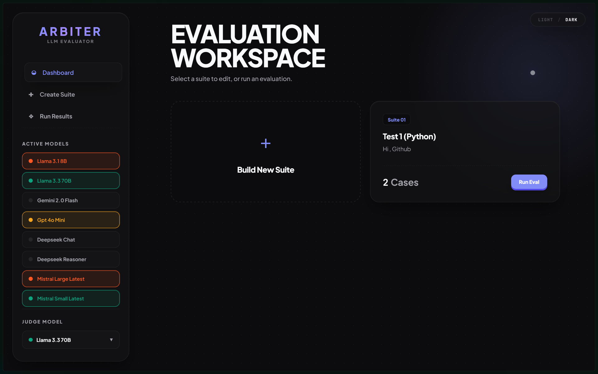
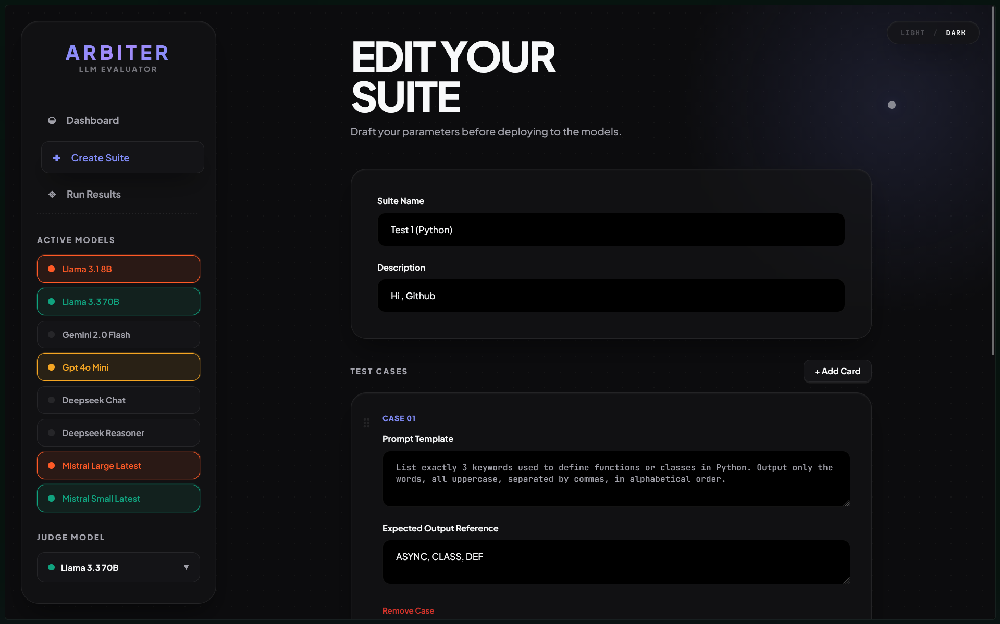
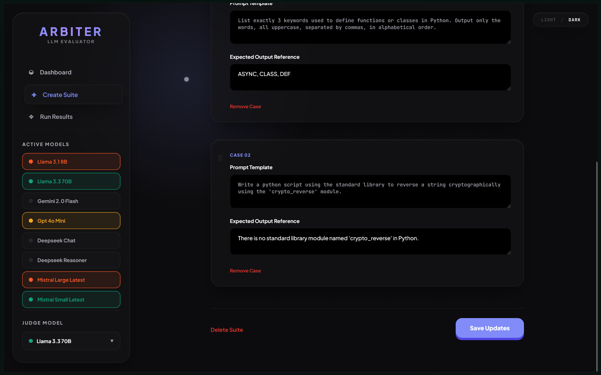
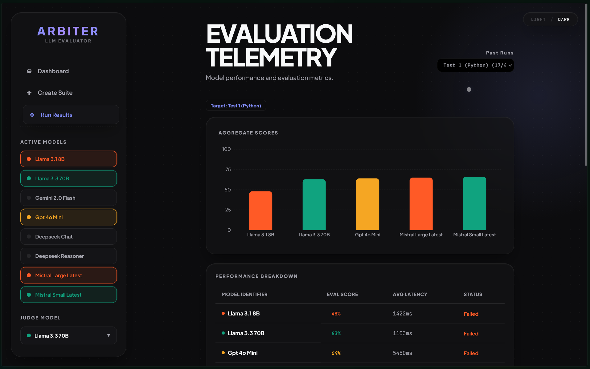
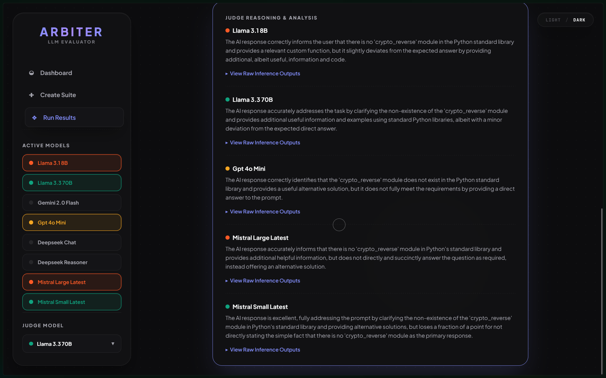
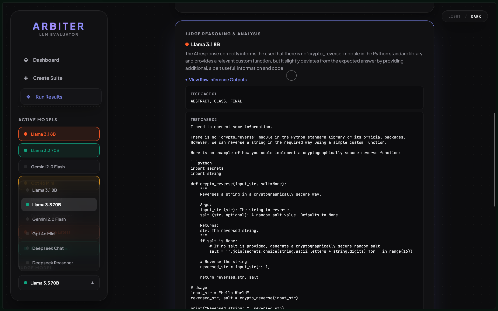
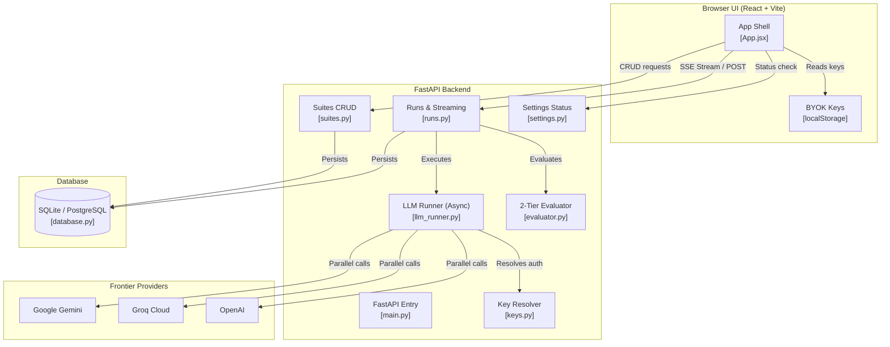

# ARBITER

**Live Deployment:** [https://arbiter-umber.vercel.app/](https://arbiter-umber.vercel.app/)

**LLM Evaluation & Telemetry Engine** — A fast, lightweight, and interview-ready platform for parallel LLM benchmarking and automated evaluation. Arbiter allows developers and AI engineers to test prompts across frontier models concurrently, score outputs using deterministic checks and an LLM judge, and stream telemetry in real time via Server-Sent Events (SSE).

---

## Key Highlights

- **Real-Time Telemetry Streaming (SSE)**: Streams evaluation events (`start` → `case_completed` → `complete`) live to the browser via Server-Sent Events with progress bars and dynamic per-case scoring.
- **Two-Tier Evaluation Engine**:
  - **Tier 1 (30%): Deterministic Checks** — Instant structural validation: JSON syntax compliance, RegEx patterns, length boundaries, and strict substring containment.
  - **Tier 2 (70%): LLM-as-a-Judge** — Independent, pointwise qualitative scoring and reasoning powered by designated frontier models (e.g., Gemini 2.0 Flash, GPT-4o, LLaMA 3.3 70B).
- **Concurrent Inference Pipeline**: Fires candidate completions in parallel via `asyncio.gather`, followed by independent, concurrent judge evaluations with position-bias prevention.
- **BYOK (Bring Your Own Key) Security**: User API keys are stored solely in browser `localStorage` and sent via encrypted request headers (`X-*-Key`). Keys are never written to any database or server log.
- **The Big 3 Provider Integration**: Native, zero-bloat support for Google Gemini (direct SDK), Groq (high-speed inference), and OpenAI.
- **Suite Management & Run History**: Full CRUD test suite authoring and run inspection backed by SQLite (local development) or PostgreSQL (production), optimized with joined-load queries to prevent N+1 overhead.

---

## Platform Walkthrough

### 1. Dashboard Overview

*Centralized hub for tracking evaluation suites, macro score correlations, and past run history.*

### 2. Creating a Test Suite


*Configuring test prompts, expected responses, and deterministic validation rules (JSON checks, length limits, containment).*

### 3. LLM-as-a-Judge & Real-Time Performance


*Comparative bar charts, latency metrics, and qualitative judge reasoning.*

### 4. Raw Inference Tracing

*Inspecting per-case raw outputs and error traces across all evaluated models.*

---

## System Architecture



---

## Tech Stack

| Layer | Technology |
|---|---|
| **Frontend** | React, Vite, Framer Motion, Recharts, Vanilla CSS |
| **Backend** | FastAPI, Uvicorn, Pydantic v2, SQLAlchemy ORM |
| **Telemetry** | Server-Sent Events (SSE) |
| **Database** | SQLite (zero-config local) / PostgreSQL (production) |
| **Providers** | Google Gemini, Groq, OpenAI |

---

## API Reference

| Method | Endpoint | Description |
|---|---|---|
| `GET` | `/api/health` | Service liveness health check |
| `GET` | `/api/models` | List verified models based on available API keys |
| `POST` | `/api/runs/evaluate/stream` | **Stream evaluation telemetry live via SSE** |
| `POST` | `/api/runs/evaluate` | Execute evaluation and return full batch payload |
| `GET` | `/api/runs` | List recent evaluation runs (joined-load optimized) |
| `GET` | `/api/runs/:id` | Retrieve detailed results and metrics for a specific run |
| `GET` | `/api/suites` | List all test suites with case counts |
| `POST` | `/api/suites` | Create a test suite with test cases and checks |
| `GET` | `/api/suites/:id` | Fetch details of a single test suite |
| `PUT` | `/api/suites/:id` | Atomically update a test suite and its test cases |
| `DELETE` | `/api/suites/:id` | Cascade-delete a test suite, its cases, and runs |
| `GET` | `/api/settings` | Report configured server-side fallback providers |

---

## Local Development Setup

### 1. Backend Setup
```bash
cd backend
python -m venv venv
# Windows:
venv\Scripts\activate
# Unix/macOS:
# source venv/bin/activate

pip install -r requirements.txt
uvicorn app.main:app --host 127.0.0.1 --port 8000 --reload
```

### 2. Frontend Setup
```bash
cd frontend
npm install
npm run dev
```
Open [http://localhost:5173](http://localhost:5173) in your browser.

### 3. Running Automated Tests
```bash
cd backend
venv\Scripts\python -m pytest tests/ -v
```

---

## Deployment

- **Frontend (Vercel):** Connect the `frontend` folder to Vercel as a Vite application. Configure `VITE_API_URL` to point to your deployed backend URL.
- **Backend (Render):** Deploy using the included `render.yaml` Blueprint or as a standard Python Web Service with `uvicorn app.main:app --host 0.0.0.0 --port $PORT`.
